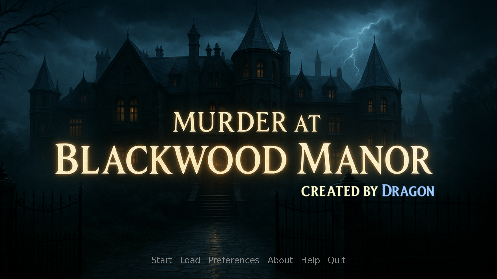
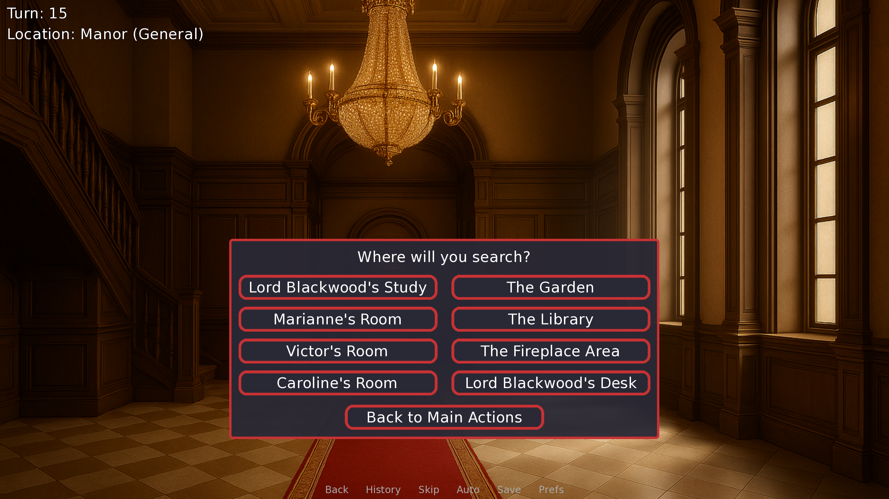
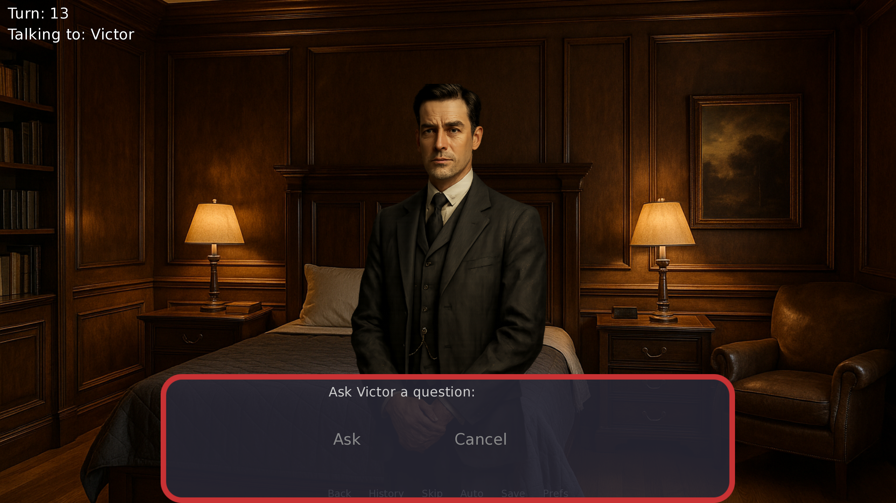
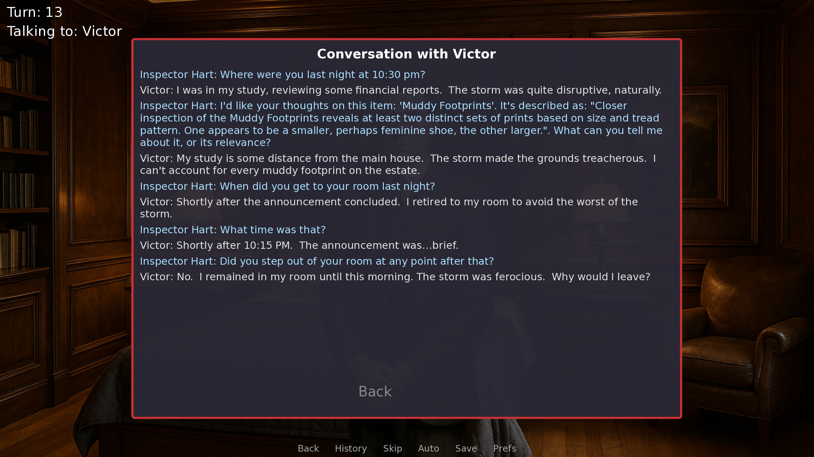
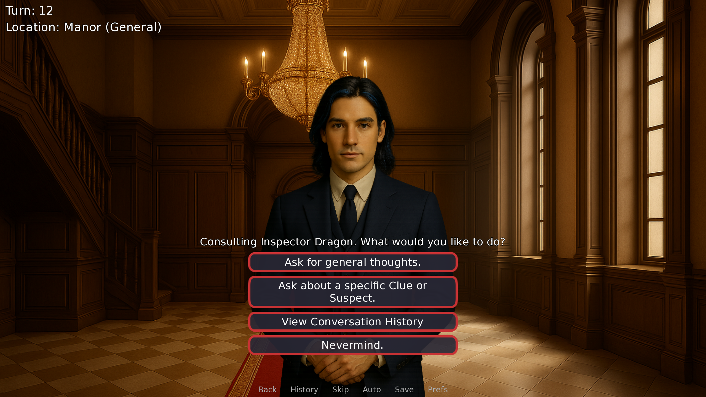

# Murder at Blackwood Manor



Murder at Blackwood Manor is an AI-powered murder mystery I built with Ren'Py, Python and the Gemini API. It combines the atmosphere and structure of a visual novel with open-ended conversations: instead of selecting from a fixed list of questions, players can type what they want to ask and receive an answer generated for that particular exchange.

The player takes on the role of Inspector Hart, investigating the death of Lord Blackwood at an isolated manor. Three suspects have their own personalities, motives and secrets. The player searches the manor, examines evidence, questions each suspect and eventually decides whom to accuse.

What interested me most was how to combine the flexibility of an LLM with a mystery that has an underlying structure. The game needs to keep track of who committed the murder, what the player has discovered and what each character knows, while still allowing conversations to unfold in different ways.

## Investigating the manor

The player can explore locations around the manor, discover clues and examine them in more detail. Evidence is organised into stages, so an initial discovery can later reveal additional information as the investigation progresses.



Each new game randomly selects the murderer from the three suspects. The game then adjusts details and relevance associated with clues around that selection. This gives the investigation a different underlying solution across playthroughs while keeping the evidence connected to the chosen scenario.

The player can return to suspects as new information becomes available, show them discovered clues and compare their answers against other testimony. Once ready, the player can make an accusation and see an ending based on whether they identified the culprit correctly.

## Open-ended suspect interrogation



I wanted the interrogations to feel less like choosing a prewritten branch and more like a conversation. Each suspect receives a prompt built from their character profile, role in the case and current investigation state. The prompt describes their personality, relationships, hidden motives, whether they are guilty, and how they should respond when confronted with particular evidence.

For every question, the game combines:

- The suspect's persona and role in the current case
- The clues the player has discovered and their current level of detail
- Relevant pressure notes from the investigation
- Recent exchanges with that suspect
- The player's current question or evidence presentation

This context is sent to Gemini to generate a response. The prompts instruct guilty suspects to protect themselves and innocent suspects to defend their innocence while still concealing their own unrelated secrets. They are designed to guide the model's behaviour, although generated responses are not guaranteed to remain perfectly consistent.

## Conversation memory and investigation state

The game maintains a separate conversation history for each suspect. When building a new prompt, it includes the most recent three exchanges with that character, while the player can review the longer recorded conversation through the interface.



The investigation state also records discovered clues, examination stages, interrogation history, selected contradictions and pressure notes. Some of these are updated through explicit game rules. For example, a particular piece of testimony can establish a contradiction with Victor's alibi once the relevant clue has been discovered. That contradiction can then add pressure to his next interaction.

I also vary the generation temperature for a guilty suspect when a pressure note is active. The aim is to let the character's responses reflect the situation while keeping the case's key facts in the game state rather than relying on the model to remember everything by itself.

## Inspector Dragon: an AI detective assistant



The player can consult Inspector Dragon, an AI-powered detective assistant, for general thoughts or for help with a specific suspect or clue. His prompt includes a summary of the investigation, such as discovered evidence, selected contradictions and snippets from recent suspect conversations.

The hint system tracks consultations and whether the player has made meaningful progress since the previous one. When a player continues to seek help without progressing, the prompt can request increasingly direct hints. Dragon is instructed to guide the investigation without directly solving the case for the player.

This gave me a second way to use the language model within the game: suspects respond from restricted character perspectives, while the assistant works from a broader summary of the investigation.

## How the AI integration works

The game builds its prompts in Python inside the Ren'Py project and sends them to the Gemini API using HTTP requests. The selected model in the current code is `gemini-1.5-flash-latest`, with generation settings supplied as part of the request.

For a suspect interaction, the processing flow is:

```text
Player question or evidence presentation
        ↓
Ren'Py interaction screen and current game state
        ↓
Suspect persona + discovered evidence + recent conversation + current input
        ↓
Gemini API request → generated response or error fallback
        ↓
Update the suspect's conversation history and display the response
        ↓
Apply relevant rule-based contradiction and pressure checks
```

I construct the persona and conversation context as a single text prompt for each request. The API payload contains that prompt in a user-message structure, along with a temperature and a maximum output length of 350 tokens. For ordinary suspect interactions, the temperature is set to `0.75`; it is raised to `0.80` when the guilty suspect has an active pressure note.

This design gives the game direct control over which details are passed into the model on each turn. It also means that the model does not need a separate persistent session for each character: the game stores the dialogue and reconstructs the relevant context when a new response is requested.

### Managing the case in code

At the start of a playthrough, the game creates a fresh copy of its evidence template and initialises a state dictionary. This stores the chosen murderer, discovered clues, clue examination stages, per-suspect conversations, turn count, detective consultations, contradictions and pressure notes.

Clue discovery and examination are handled by explicit functions. A clue can advance when its next-stage condition is met, such as being examined, the investigation reaching a particular turn, or the murderer being under pressure. Some later descriptions and relevance text are selected according to the murderer. These authored conditions give the generated dialogue a changing case to refer to.

For Inspector Dragon, a separate function builds a compact summary of the investigation. It includes current clue details, selected contradictions, consultation and progress information, and excerpts from suspect conversations. A focused request can also add the particular clue or suspect the player wants to discuss.

### Request and response handling

The API call uses a JSON request and a 90-second timeout. When a response is available, the game extracts the generated text from the first candidate and records the player's input and the response in the relevant conversation history. It also checks for conditions such as blocked prompts, safety-related stops, truncated output, missing candidates and unexpected response formats.

Timeouts, network failures and unsuccessful HTTP responses produce fallback messages for the player. The interface also provides a loading state while a response is being requested.

The approach is prompt- and state-driven: the game constructs the context for each request from its own data structures, then incorporates the generated text into the conversation history and interface. The code uses a small number of explicit rule-based checks for investigation events, rather than a general-purpose contradiction detector.

## Playing

1. Start a new investigation as Inspector Hart.
2. Search locations and examine the clues you discover.
3. Question Marianne, Victor and Caroline using your own words.
4. Present evidence and revisit earlier conversations as the case develops.
5. Consult Inspector Dragon if you want another perspective.
6. Make an accusation when you think you have identified the murderer.

## Project structure

```text
murder-at-blackwood-manor/
├── game/
│   ├── script.rpy       # Story, game state, prompts and API interaction
│   ├── options.rpy      # Ren'Py project configuration
│   ├── styles.rpy       # Interface styles
│   ├── screens/         # Menus and interface screens
│   ├── images/          # Character and location artwork
│   └── gui/             # Interface assets
└── project.json
```

## Running the game

The game requires the [Ren'Py SDK](https://www.renpy.org/), an internet connection and a Gemini API key with access to the configured model. The game sends player questions and game context to the Gemini API to generate dialogue.

Set `GEMINI_API_KEY` in the environment before starting the Ren'Py launcher. For example, in PowerShell:

```powershell
$env:GEMINI_API_KEY = "your-api-key"
```

On macOS or Linux:

```bash
export GEMINI_API_KEY="your-api-key"
```

Launch Ren'Py from that same environment, select the `murder-at-blackwood-manor` project and choose **Launch Project**. The project uses the Python `requests` library, which needs to be available to Ren'Py's Python environment. The code currently specifies `gemini-1.5-flash-latest`; model availability may require updating this setting for your API account.

The key is read from an environment variable and should not be committed to the repository.

## What I explored

This project brought together several things I enjoy working on:

- Designing character-conditioned LLM prompts for interactive dialogue
- Building prompts dynamically from game state and recent conversation history
- Combining generated responses with authored evidence and explicit game rules
- Managing multiple character histories and a changing investigation
- Designing adaptive hints around player progress
- Integrating an external model API into a playable Ren'Py interface
- Handling API failures and presenting feedback to the player

More than anything, the project was an opportunity to explore how an LLM can make an authored game feel more open-ended while the underlying mechanics continue to shape the experience.
